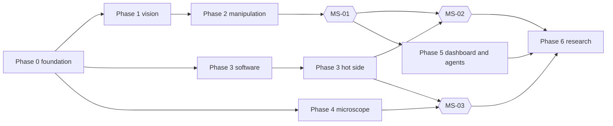

# Lab integration migration plan

This folder is the execution plan for moving the WuLab instrument code into this repo and running every lab device from the Olares host.
Agents execute it. An orchestrator (an agent or the repo owner) schedules it. The repo owner, shc0507, approves it.

| File | Content |
| --- | --- |
| `README.md` | Goal, decisions, target state, roles, workflow, rules, shared procedures, prompts, phases, risks, open questions |
| `tasks.md` | One card per task: goal, inputs, steps, acceptance, docs, notes |
| `tasks.toml` | The task graph: ids, owners, sizes, review level, dependencies, write sets |
| `doc-pairs-pending.txt` | Created by DOC-01. Docs that still lack their other-language pair |

Rules for this folder:

- It is for agents. Write it in English only.
- Status lives in GitHub issues (GOV-01), never in these files.
- Change the plan itself (a new task, a changed dependency, a corrected step) in its own pull request. The repo owner reviews it.
- `tests/test_migration_plan.py` checks that `tasks.toml` and `tasks.md` agree and that the graph has no cycles.
- CLN-02 deletes this folder and that test when the migration ends.

## 1. Goal

Today this repo controls the MG400 arm, the PGEA gripper, the three-axis stage and three AC410 cameras on Olares.
Four WuLab repos hold the rest of the lab's instrument code. Each is a separate Windows app with its own copy of shared code.

End state:

1. Every lab device connects to the Olares host: robot, gripper, stage, cameras, thermal camera, furnace and gas controllers, microscope camera, objective turret and focus motors.
2. Each device has one service on Olares. Every service speaks the same contract (section 4.3) and has a demo mode.
3. The WuLab code lives in this repo as packages under `src/`. The WuLab repos are marked as moved.
4. A control plane (the orchestrator) runs recipes across devices: QR-verified tray transfers, chip load into the crucible, furnace programs, unload after cooling, microscope images through the furnace window.
5. People use web pages. LLM agents use an MCP gateway whose actuation requests wait for human approval.

The migration is done when the three milestones pass on hardware:

| Milestone | Task | What runs |
| --- | --- | --- |
| 1 | MS-01 | The robot moves a chip between tray slots. Vision finds it, the QR label confirms it before and after. |
| 2 | MS-02 | The robot places a chip in the crucible, the stage inserts it, a short furnace program runs, the robot takes it back after the thermal check. |
| 3 | MS-03 | The stage moves the chip under the furnace window. The microscope selects an objective, autofocuses and saves an image under the chip's ID. |

Phase 5 adds the lab dashboard and the agent gateway. Phase 6 (closed-loop optimization) is research that continues after the migration.

## 2. Decisions

### 2.1 Owner decisions (2026-10-30)

| Id | Decision |
| --- | --- |
| D1 | Move every device and service to Olares. |
| D2 | Move the WuLab code into this repo, restructure it, and own it. Do not depend on the WuLab repos. |
| D3 | This repo becomes the lab control plane. Rename the package `mg400_agent` to `mg400`. Keep the repo name for now. |
| D4 | Store model weights as a GitHub Release asset with a manifest. The installer downloads the file and checks its hash. |
| D5 | Furnace without a controlling client: a sequence runs to its planned end, an open-ended setpoint stops heating after a grace period, new commands wait until a client takes control, and gas moves into the sequence steps. |
| D6 | Vision runs as its own process on Olares in its own environment. It may become an Olares app later. |
| D7 | First milestone: vision-guided, QR-verified tray transfer. |
| D8 | The LLM agent returns in phase 5, behind approval gates. |
| D9 | Human-facing docs exist in Chinese and English. Agent-facing docs (this folder, `AGENTS.md`, `docs/agents/`) stay English only. |

### 2.2 Facts from the lab

- "Chip" and "wafer" name the same object, the sample. This plan says "chip". The vision model's class is `Chip`.
- The stage's Insert axis carries the crucible, which holds the chip, into the furnace.
- The robot reaches the crucible when the Insert axis brings it to the load position.
- The microscope sits above a transparent window in the furnace top. The stage moves the crucible under the window, and the microscope watches the chip inside the furnace. The robot never goes under the microscope.
- The camera setup is not final. Which camera took the YOLO training images is not known.
- Olares has an RTX 5090 with 32 GB. Other Olares apps (for example an LLM) may share it.

Hardware freeze: the owner makes no hardware changes for now (answer to Q-04, 2026-10-30). Device moves, wiring and mounting wait: H-04 to H-07, H-09, mounting the tag in H-08, and installing a cutoff in H-11. Inventories, measurements, reviews, decisions and all software tasks go on. Software runs in demo and rehearsal mode until the freeze ends.

### 2.3 Plan defaults

The plan picks these defaults. GOV-02 records them as ADRs. Change one only through its ADR.

| Topic | Default | ADR |
| --- | --- | --- |
| Service contract | Section 4.3 | 0001 |
| Repo layout and moved code | Section 4.1 and P-MOVE | 0002 |
| One host | Section 4.2, the USB plan in OPS-01 | 0003 |
| Large files | `config/assets.toml`, installer download, host data under `/var/lib/mg400` | 0004 |
| Furnace without a client, restart, shutdown | FUR-03 card | 0005 |
| Vision runtime | `/opt/mg400/.venv-vision`, PyTorch 2.7+ built for CUDA 12.8, only `opencv-python-headless`, GPU memory cap | 0006 |
| Docs | Unsuffixed file in Chinese, `.en.md` in English, pair check in CI | 0007 |
| Agents | MCP gateway, read tools free, actuation through approvals | 0008 |
| Web framework | New services: Flask and waitress, like the stage panel. The moved thermal service keeps FastAPI and uvicorn. | 0009 |

## 3. Sources

| Source repo | Commit | What moves | Task |
| --- | --- | --- | --- |
| `WuLabPrinceton/Visual-Localization` | `cc329b3` | `visual_localization/predict.py`, `test_coordinates.py` | VIS-01 |
| `WuLabPrinceton/Chemistry-Integration` | `646ddef` | `Identify_Wafer/qr_detector.py`, `qr_micro_recovery.py`, three test files, crops of `sample_img/` | VIS-02 |
| `WuLabPrinceton/Chemistry-Integration` | `646ddef` | `Thermal_Cam_Control/thermal_cam/**`, its tests and notices | THM-01 |
| `WuLabPrinceton/FurnaceCode` | `ebbf84b` | `furnace.py` | FUR-01, FUR-03 |
| `WuLabPrinceton/FurnaceCode` | `ebbf84b` | `app.py`, `templates/index.html`, `static/app.js`, `static/styles.css` | FUR-04 |
| `WuLabPrinceton/FurnaceCode` | `ebbf84b` | `run_recordings.py`, `run_video_compiler.py` | FUR-05 |
| `WuLabPrinceton/FurnaceCode` | `ebbf84b` | `camera.py`, `toupcam_capture.py`, `python/toupcam.py` | TPC-01 |
| `WuLabPrinceton/FurnaceCode` | `ebbf84b` | Agent files, as ideas only | AGT-03 |
| `WuLabPrinceton/Objective-Control` | `3a2dad0` | `camera.py`, `toupcam_capture.py`, `python/toupcam.py` | TPC-01 |
| `WuLabPrinceton/Objective-Control` | `3a2dad0` | Autofocus, ArUco, calibration and capture modules, `MotorController`, `usb_camera_devices.py`, two test files | MIC-02 |
| `WuLabPrinceton/Objective-Control` | `3a2dad0` | Calibration images and CSV files, as host data | MIC-05 |

These files do not move:

- Binaries: both copies of `toupcam.dll` and `models/weights.pt`. See D4 and the asset tasks.
- Desktop GUIs: `Dual_A4988_GUI.py` (except `MotorController`), `cam2_gui.py`, `experiment_gui.py` (its logic moves in MIC-05), `Focus_Control.py`, `qr_gui.py`, `ui_theme.py`, `tests/test_qr_gui.py`.
- `Arduino_Firmware/Linear_Actuator_Controller`. It is a different device and protocol.
- `FurnaceCode/test_gas.py`. It is a hardware script, not a test. Importing it opens gas valve 0 at 30 % for 10 s. Never copy it into `tests/`.
- Visual-Localization `run_demo.py` (it needs assets that are not in the repo) and the model download helpers (replaced by the asset manifest).
- Windows setup text (Zadig, COM ports, PowerShell) and the hardware verification records in the READMEs.

Get a source with `git clone https://github.com/WuLabPrinceton/<repo>` and `git -C <repo> checkout <commit>`. The repos may be private, so the worker needs read access.
Use only the commits in this table. If a newer commit must be used, update this table in a plan PR first.
Take the authors for `Co-authored-by:` trailers from `git -C <repo> log --format='%an <%ae>' <commit> -- <paths>` at move time. Do not copy their addresses into docs.

## 4. Target state

### 4.1 Repository layout

```text
src/
  mg400/              robot core, stdlib only (renamed from mg400_agent in FND-01)
    client.py         Python client for the robot service (FND-07)
    sim/              runnable MG400 simulator (SIM-01)
  stage_controller/   stage panel and driver (existing)
  labkit/             shared service code: auth, lease, events, describe, Flask contract blueprint, HTTP client
  vision/             localizer, QR reader, frames, calibration, tray model, service
  thermal_cam/        Thermal Master P1 driver and service (moved)
  furnace/            AI-808 and MFC driver, simulator, run logic, service, page, recordings
  toupcam_camera/     one Toupcam camera class and the vendor wrapper
  cameras/            UVC camera lookup and capture (from Objective-Control)
  microscope/         turret and focus motors, autofocus, objective switching, calibration, service, panel
  orchestrator/       recipes, runner, skills, stations, zones, run store, service, dashboard
  gateway/            MCP gateway and agent clients (phase 5)
  analysis/           image metrics and optimizer (phase 6)
apps/control_panel/   robot panel (existing)
recipes/              lab recipes in TOML
config/
  robot.toml          robot address (existing)
  assets.toml         large-file manifest (FND-08)
  trays/              tray geometry (CAL-02)
  systemd/            unit files
  udev/               udev rule templates (OPS-01)
deploy/               installer, mg400ctl and labctl, services.toml (FND-09)
firmware/
  three-motor-demo/   stage firmware (gains limits and homing in STG-01)
  microscope-axes/    turret and focus firmware (MIC-01)
docs/                 human docs, Chinese X.md and English X.en.md
docs/adr/             decisions (GOV-02)
docs/agents/          agent procedures, English only
tests/                all tests; tests/fixtures/ for small test data
```

Package rules:

- One top-level package per area, like `stage_controller` today. Add each to `[tool.hatch.build.targets.wheel] packages`.
- Each light dependency group joins `[tool.uv] default-groups`, so CI installs it and runs its tests.
- The heavy `vision-gpu` group never joins the default groups. CI never installs it.

### 4.2 Services, settings and data on Olares

| Service | `mg400ctl` name | Unit | Port | Settings prefix | Python env | Device access |
| --- | --- | --- | --- | --- | --- | --- |
| Robot panel | `web` | `mg400-web-panel` | 8766 | `MG400_PANEL_` | `.venv` | network |
| Stage panel | `stage` | `mg400-stage-panel` | 8767 | `MG400_STAGE_` | `.venv` | `dialout` |
| Camera preview | `camera` | `mg400-camera-preview`, `mg400-camera-capture` | 1985 (go2rtc 1984, loopback) | `MG400_CAMERA_` | `.venv` | `video` |
| Gripper collector | `collector` | `mg400-gripper-collector` | none | none | `.venv` | `dialout` |
| Thermal | `thermal` | `mg400-thermal` | 8768 | `MG400_THERMAL_` | `.venv` | udev group (OPS-01) |
| Furnace | `furnace` | `mg400-furnace` | 8769 | `MG400_FURNACE_` | `.venv` | `dialout`, udev group for the Toupcam camera |
| Microscope | `microscope` | `mg400-microscope` | 8770 | `MG400_MICROSCOPE_` | `.venv` | `dialout`, `video`, udev group |
| Vision | `vision` | `mg400-vision` | 8771, loopback | `MG400_VISION_` | `.venv-vision` | GPU device nodes |
| Orchestrator and dashboard | `orch` | `mg400-orchestrator` | 8772 | `MG400_ORCH_` | `.venv` | network |
| Agent gateway | `gateway` | `mg400-gateway` | 8773, loopback | `MG400_GATEWAY_` | `.venv` | network |

Settings rules:

- Every setting comes from `/etc/mg400/mg400.env`. Each service reads `<PREFIX>BIND`, `<PREFIX>PORT` and `<PREFIX>TOKEN` like the existing panels.
- `MG400_OPTIONAL_SERVICES` (FND-09) lists the optional services that this host runs. The installer prepares only those.
- Code and unit files hold no host values. `tests/test_systemd_units.py` already rejects `100.64.`, `/olares`, `/opt/mg400-` and `/root/`.

Data on the host:

| Path | Content | Task |
| --- | --- | --- |
| `/var/lib/mg400/models/` | Model weights from the asset manifest | FND-08, VIS-05 |
| `/var/lib/mg400/calibration/cameras/` | Camera-to-robot homographies, one file per camera path | CAL-01 |
| `/var/lib/mg400/calibration/microscope/` | Turret, autofocus and reference-view data | MIC-05 |
| `/var/lib/mg400/stations.toml` | Taught robot stations | ORC-02 |
| `/var/lib/mg400/tool.toml` | Gripper tool offset | ORC-02 |
| `/var/lib/mg400/stage.toml` | Stage steps per mm, soft limits, named positions and poses | STG-02 |
| `/var/lib/mg400/thermal/rois.toml` | Named thermal regions | THM-03 |
| `/var/lib/mg400/furnace/state.json` | Running sequence state | FUR-03 |
| `/var/lib/mg400/runs/` | Run store: SQLite index and run files | ORC-01 |
| `/var/lib/mg400/recordings/` | Furnace video before archiving | FUR-05 |

All of these use owner `1000:1000`, directories `0750`, files `0640` or `0600`. The installer creates the directories. OPS-03 adds them to backup and host migration.

### 4.3 Instrument service contract v1

ADR-0001 is the normative text once GOV-02 writes it. Until then this section is the reference.

| Method and path | Rule |
| --- | --- |
| `GET api/describe` | `{service, version, contract: 1, demo, zones, lease_seconds, on_lease_expiry, commands: {name: {params: <JSON Schema>, any_client: bool}}}` |
| `GET api/state` | `{service, seq, ts_unix, demo, connected, busy, locked, fault, lease, last_command, ...}`. `fault` is `null` or `{code, message}`. `last_command` is `null` or `{id, action, client, result, message, finished_at}` with `result` in `ok`, `failed`, `rejected`, `stopped`. Device fields carry units in their names: `pv_c`, `ramp_c_per_min`, `flow_pct`, `x_mm`, `r_deg`. |
| `POST api/command` | Body `{"action": "...", ...}`. Header `X-MG400-Client: <id>`. Returns `202` with `{command_id, state}`. Completion shows in `state.last_command`. |
| `POST api/stop` | Any client, any time, idempotent. Body `{"wait_s": 0..15}`. Returns `{stop: "confirmed" | "pending" | "unconfirmed", state}`. |
| `POST api/heartbeat` | Takes or renews the control lease for `X-MG400-Client`. Returns `409` if another client holds it. |
| `POST api/release` | Releases the lease if the caller holds it. |
| `GET api/events?since=<seq>` | `{events: [{seq, ts_unix, level, message, fields}], next}`. The same events the service writes to its journal. |
| `GET api/ws` | Optional state push with the robot service's protocol 1. |

Contract rules:

- POST requests carry `Content-Type: application/json` and `X-MG400-Client`. Browsers must send these headers through a script, which blocks cross-site form posts.
- Errors: `400` invalid request, `401` token, `403` host, origin or access rule, `409` state conflict or lease held by another client, `415` not JSON, `503` device link lost. Body `{"error": "..."}`.
- Access: bearer token of at least 24 printable ASCII characters. Without a token the service accepts only loopback `Host` values and rejects forwarded headers, as the panels do now. FND-04 moves these rules into `labkit.auth`.
- Lease: one controlling client id at a time, 1 to 128 printable ASCII characters. The default lease is 3 s. Read-only requests and `stop` need no lease.
- Lease expiry: motion services stop motion. The furnace follows D5. Each service states its action in `on_lease_expiry`.
- Unknown outcome: when a command result is unknown, the service sets `locked` and a `fault`, and refuses commands except `stop` until a person clears it. No service retries motion by itself.
- Demo mode: `--demo` swaps the device for a simulator. `state.demo` and `describe.demo` say so.
- Version: a client refuses a service whose `contract` value differs from its own.
- The robot service keeps its current protocol and adds `describe`, `stop`, `events` and `last_command` (FND-06).

### 4.4 Safety model

| Layer | Owner | Mechanism |
| --- | --- | --- |
| Inside one device | The device's service | Limits, stop confirmation, leases, hold timeouts, unknown-outcome lock. Existing robot and stage rules stay. |
| Between devices | Orchestrator | Zones (`tray`, `crucible-load`, `furnace-tube`) and preconditions such as "furnace in STOP/COOLING" or "crucible below the thermal limit" (ORC-04, XDV-01). |
| Furnace window | Stage and microscope services | Stage soft limits in the firmware and the host keep the crucible clear of the tube and the window (STG-01, STG-02). Focus limits and a known focus zero keep the objectives off the window, and the turret turns only at the clearance position (MIC-01, MIC-03). |
| People and automation | Services | While the orchestrator holds a service's lease, the panels of that service can only stop it. |
| Physical | Lab (H-11) | E-stop chain, independent over-temperature cutoff. Software never replaces them. |

## 5. Roles

| Role | Who | Does |
| --- | --- | --- |
| Owner | shc0507 | Approves this plan, ADRs and every `review = "human"` PR. Answers open questions. |
| Orchestrator | An agent session or the owner | Keeps the issues current, starts workers, reviews or routes PRs, merges in order, stops at human gates. |
| Worker | An agent session | Executes one task card on one branch and opens one PR. |
| Reviewer | An agent session or the owner | Checks a PR against the reviewer checklist (section 9.3). |
| Operator | A person in the lab | Executes `H-` tasks and supervises every hardware session (P-HW). |

## 6. Workflow

### 6.1 Tracking

GOV-01 creates one map issue and one child issue per task, with labels and native blocked-by links. It follows `docs/agents/issue-tracker.md`.

- The issue is the status. A worker claims a task by assigning the issue. Merging the PR closes it.
- A human task closes when the operator comments the result on the issue.
- Results of hardware sessions go in issue comments, never in docs.

### 6.2 Ready tasks

A task is ready when all of these are true:

1. Every id in its `deps` is closed.
2. Nobody is assigned.
3. Its card has no unanswered "Ask first" item.

### 6.3 Parallel work

- Default limit: 4 workers at a time.
- Two open PRs must not change the same file, except the shared files below.
- Shared files: `pyproject.toml`, `uv.lock`, `AGENTS.md`, `deploy/services.toml`, `deploy/mg400.env.example`, `deploy/install.py`, `deploy/mg400ctl`, `tests/test_systemd_units.py`, `tests/test_deploy_install.py`, `tests/test_deploy_mg400ctl.py`, `docs/deploy*.md`, `docs/development*.md`, `docs/olares*.md`, `docs/agents/migration/doc-pairs-pending.txt`.
- Changes to shared files are additions where possible: a new table row, a new group, a new registry entry.
- The orchestrator merges PRs that touch shared files one at a time. The next such PR merges `main` before its own merge.
- Never hand-merge `uv.lock`. Merge `main`, then run `uv lock`.

### 6.4 Branches, commits and pull requests

- Branch: `mig/<id in lowercase>-<short-slug>` from the latest `origin/main`, for example `mig/fnd-01-rename-package`.
- One task per branch and per PR.
- Commit message: an imperative subject and a body that describes what was done (an `AGENTS.md` rule). Add the trailer `Task: <ID>`.
- Moved code also gets `Source: WuLabPrinceton/<repo>@<commit> <paths>` and one `Co-authored-by:` trailer per source author.
- PR title: `[<ID>] <card title>`. Open it as a draft. Mark it ready when the checks pass.
- Merge with a merge commit, as the repo does today. Update a branch by merging `main`. Do not rebase or force-push a branch that someone else may have checked out.

PR body:

```markdown
Task: <ID> (docs/agents/migration/tasks.md, card <ID>)

## What changed
<short list>

## Checks
- [ ] uv run pytest
- [ ] node --test tests/*.mjs
- [ ] uv run ruff check .
- [ ] uv run ruff format --check .

## Docs
- [ ] Chinese and English updated together, or no human doc changed

## Hardware
- [ ] None, or: needs <H-id> before use on hardware

## Left behind
<moved code only: source files not moved, and why>
```

### 6.5 Review and merge

- `review = "agent"`: a reviewer agent applies the checklist in 9.3. When CI is green, the orchestrator merges.
- `review = "human"`: the owner approves before the merge.
- Every PR needs green CI.

### 6.6 Blocked work

When a card's assumption is wrong, a dependency is missing, or a hardware fact is unknown:

1. Stop. Do not widen the scope and do not work around a safety rule.
2. Comment on the issue: what blocks, what you checked, what you need.
3. Add the label `needs-info`. Unassign yourself if you cannot continue.

### 6.7 Gates

Gates are human tasks that later tasks depend on. The orchestrator stops at a gate and asks the owner.

| Gate | Closed by | Unblocks |
| --- | --- | --- |
| G0 Plan approved | H-01 | GOV-01 and the issue-tracked workflow |
| G1 Cameras final | H-09 | VIS-07, CAL-01, H-22 |
| G2 Robot validated | H-17 | MS-01 |
| G3 Stage validated | H-18 | MS-02 |
| G4 Hot side validated | H-19, H-20, H-11 | MS-02 |
| G5 Microscope validated | H-21 | MS-03 |
| G6 Unattended operation approved | H-24 | OPT-03 |
| G7 Agent approval policy | H-23 | AGT-02 |

### 6.8 Plan changes

A worker that finds a wrong card does not edit it in the task PR. It reports the problem on the issue. The orchestrator opens a plan PR that changes `tasks.toml` and `tasks.md` together, and the owner reviews it.

## 7. Rules for every task

### 7.1 Safety

1. Agents never send commands to real hardware: the robot, gripper, stage, furnace, gas controllers, cameras, Arduinos or thermal camera. Hardware work is an `H-` task with an operator at the e-stop (P-HW).
2. Tests never open real devices or real network addresses. Use the simulators and demo transports. Never name a hardware script `test_*.py` and never put one under `tests/`.
3. Keep the existing safety behavior: control leases, stop confirmation, the unknown-outcome lock, joint range checks, the gripper command lock, the stage hold timeout, and no automatic motion retries. Change it only when a card says so. Such a card has `review = "human"`.
4. Furnace and gas: respect the configured caps. No code path starts heat or gas without an explicit command or recipe step. Furnace tests use the simulator only.
5. Do not weaken access control: token length, loopback defaults, Host, Origin and forwarded-header checks, or file permissions.
6. Do not delete or bypass lock files or gripper command locks.
7. Agents do not deploy. The owner installs, upgrades and starts services on Olares. For migration tasks, agents do not log in to Olares or use its web interface, although `AGENTS.md` allows that for other work.

### 7.2 Code

- The robot core (`src/mg400`, `apps/control_panel`) stays stdlib-only. So do `labkit.auth`, `labkit.lease`, `labkit.events` and `labkit.client`.
- No side effects at import time: no device opened, no thread started, no file written.
- Linux only. Remove Windows-only code when you move it.
- Python 3.12 or later after FND-02. Follow the ruff rules in `pyproject.toml`.
- Every service has `--demo`.
- Every new dependency goes into a dependency group, and `uv.lock` is regenerated.

### 7.3 Files

- No binary file and no file over 1 MB in Git. FND-03 enforces this. Weights, native libraries and data go through the asset manifest or host data.
- No secrets: no tokens, keys or passwords.
- Never edit generated files by hand.

### 7.4 Docs

- The `AGENTS.md` documenting rules apply: current procedures only, no run records.
- After DOC-01, change a human doc and its pair in the same PR. Before the pair exists, change the Chinese file only. The DOC task that creates the pair copies the change.
- A new code area gets a row in the `AGENTS.md` "Reading the codebase" table.
- Agent docs stay English only.

### 7.5 Context

- Follow `AGENTS.md` "Reading the codebase". Read only the files your card needs.
- In a source repo, read only the files your card lists.

## 8. Shared procedures

Cards refer to these by name.

### P-CHECKS

Run the area tests while you work. Run all of these before the PR:

```sh
uv sync
uv run pytest
node --test tests/*.mjs
uv run ruff check .
uv run ruff format --check .
```

### P-MOVE

Move code from a WuLab repo:

1. Check out the commit from section 3.
2. Copy only the files the card lists. Never copy binaries, images, CSV data, IDE files or virtual environments.
3. Put the code in its package under `src/`. Use package imports, no `sys.path` changes, no GUI code. Expose command-line tools as `python -m <package>` or `[project.scripts]` entries.
4. Port it: settings instead of COM ports and fixed paths, `/dev/serial/by-id/` and `/dev/v4l/by-path/` names, V4L2 instead of DirectShow, no Windows fonts or drive letters.
5. Keep the behavior. Change algorithms only where the card says so.
6. Move the listed tests to `tests/` and make them pass offline. pytest runs `unittest` test cases unchanged.
7. Add the package to the wheel package list and its dependencies to the card's group. Run `uv lock`.
8. Add the provenance trailers (section 6.4) and an `AGENTS.md` area row.
9. List every source file that you did not move, and why, in the PR body.

### P-SERVICE

Build a contract service:

1. A service object with `describe()`, `snapshot()`, `command(action, args, client)`, `stop(client, wait_s)` and `on_lease_expired()`. Device access happens only in these methods, under one lock.
2. `start()` starts the poll thread. Importing the module starts nothing.
3. `create_app(service, *, token, base_path)` returns a Flask app with the `labkit` contract blueprint and any page routes.
4. `__main__.py` reads `MG400_<SERVICE>_*` settings, accepts `--bind`, `--port` and `--demo`, checks the token rule with `labkit.auth`, exits with status 2 on a configuration error, and serves with waitress.
5. On SIGINT, SIGTERM or SIGHUP it does what the card says (stop outputs or keep a program), then exits. `src/stage_controller/__main__.py` shows the pattern.
6. Tests use the demo mode and `tests/contract_helpers.py` (FND-05).

### P-DEPLOY

Add a service to the host:

1. Unit file `config/systemd/mg400-<service>.service`. Follow the rules that `tests/test_systemd_units.py` checks: user and group 1000, `UMask=0077`, `Restart=on-failure`, no `[Install]`, the shared `EnvironmentFile`, `WorkingDirectory=/opt/mg400`, `UnsetEnvironment` for tokens it does not check, only its device groups, `RestartPreventExitStatus=2`.
2. An entry in `deploy/services.toml` (FND-09).
3. Settings with comments in `deploy/mg400.env.example`. The installer fills empty `*_TOKEN` values.
4. Tests: `tests/test_systemd_units.py`, `tests/test_deploy_install.py`, `tests/test_deploy_mg400ctl.py`.
5. Docs in both languages: the service tables in `docs/deploy*.md`, and the VPN rule and bind address in `docs/olares*.md`.

### P-DOCS

- Change both language files in the same PR, with the same structure. The pair check must pass.
- Write Chinese with the jianming-zhongwen skill and English human docs with the asd-ste100 skill, as `AGENTS.md` says.

### P-HW

A supervised hardware session:

1. The operator is present, can reach the e-stop, and the work area is clear.
2. Run the same steps in rehearsal or demo mode first.
3. Use the lowest speeds and temperatures. Furnace tests use inert gas only unless the owner approves otherwise.
4. Do one action at a time and read the state after each one.
5. Stop at the first unexpected behavior. Save the service logs with `mg400ctl logs <name>`.
6. Write the result in the issue. Put only procedures and limits that future users need into the docs.

## 9. Prompts

### 9.1 Orchestrator prompt

```text
You orchestrate the lab integration migration in shc0507/dobot_mg400.
Read AGENTS.md and docs/agents/migration/README.md. tasks.toml is the task graph.
Repeat:
1. Read the map issue and its child issues. A task is ready per README 6.2.
2. Pick up to 4 ready agent tasks whose write sets do not overlap, except shared files (README 6.3).
3. Start one worker per task with the worker prompt (README 9.2).
4. For each PR: wait for CI, run the reviewer checklist (README 9.3), and ask the owner when the task has review = "human".
5. Merge in dependency order, one shared-file PR at a time. Close the issue.
6. When only human tasks block progress, list them for the owner with what each one unblocks, then stop.
Never start a task whose deps are open. Never merge red CI.
```

### 9.2 Worker prompt

```text
You are a worker in shc0507/dobot_mg400. Task: <ID>, <title>.
1. Read AGENTS.md, docs/agents/migration/README.md sections 6 to 8, and the card for <ID> in docs/agents/migration/tasks.md.
   Read your write set in tasks.toml. Read only the files the card names and the files you change.
2. Assign the issue to yourself. Create the branch mig/<id>-<slug> from the latest origin/main.
3. Do the steps. Stay inside the write set. If you must change another file, stop and ask the orchestrator.
4. Run the area tests while you work and P-CHECKS before the PR.
5. Update docs in both languages when the card lists docs.
6. Open a draft PR with the README 6.4 body. Mark it ready when the checks pass.
7. Report what changed, the check results, open questions, and any hardware validation still needed.
Never send commands to real hardware. Never weaken a safety rule to make a test pass.
```

### 9.3 Reviewer checklist

1. The diff stays inside the card's write set.
2. Every "Done when" item holds, and CI is green.
3. Tests cover the new behavior and open no device, port or external address.
4. No safety rule from section 7.1 got weaker. Safety-relevant changes have `review = "human"`.
5. Human docs changed in both languages, and the pair check passes.
6. No binary, no file over 1 MB, no secret.
7. Moved code has the `Source:` and `Co-authored-by:` trailers, and the PR lists the files left behind.
8. A new code area has its `AGENTS.md` row.
9. The commit message says what was done.

## 10. Phases and order

`tasks.toml` decides the order. This table gives the overview.

| Phase | Goal | Agent tasks | Human tasks | Exit |
| --- | --- | --- | --- | --- |
| 0 Foundation | Rename, Python 3.12, guards, bilingual docs, ADRs, labkit, robot contract and client, assets, registry, simulator | GOV-01, GOV-02, FND-01..10, DOC-01..10, SIM-01 | H-01; start H-02, H-03, H-10..13, H-15, H-16 now | The robot client works against the simulator; every human doc has its pair |
| 1 Vision | Localizer, QR reader and vision service on Olares | VIS-01..06 | H-09, H-14 | The camera page shows chip boxes and labels |
| 2 Manipulation | Robot speed and grasp result, orchestrator, stations, calibration, tray model | ROB-01..02, ORC-01..05, OPS-03, VIS-07..08, CAL-01..03, MS-01 | H-08, H-17, H-22 | MS-01 passes on hardware |
| 3 Hot side | Thermal, furnace, Toupcam, stage homing, crucible handoff | OPS-01, THM-01..03, FUR-01..04, TPC-01..02, STG-01..02, XDV-01, MS-02 | H-04, H-05, H-07, H-18..20 | MS-02 passes on hardware |
| 4 Microscope | Firmware, algorithms, service, panel, calibration data, recordings | MIC-01..06, FUR-05, MS-03 | H-06, H-21 | MS-03 passes on hardware |
| 5 People and agents | Dashboard, chip passport, MCP gateway, approvals, proxy | DSH-01..02, AGT-01..03, OPS-02 | H-23 | An agent proposes a transfer that runs only after approval |
| 6 Research and cleanup | Image metric, optimizer, unattended runs, cleanup | OPT-01..03, CLN-01..02 | H-24 | The plan folder is removed |

Phases overlap. Phase 3 software (THM-01, FUR-01, FUR-02, TPC-01, STG-01) can start as soon as phase 0 ends.



Critical path: FND-01, FND-02, DOC-01, GOV-02, FND-05, FND-06, FND-07, ORC-01, ORC-02, ORC-03, MS-01, then MS-02.

Human tasks to start now, because they take long and change no hardware: H-02 (firmware recovery), H-03 (USB inventory and purchases), H-10 (furnace rules), H-11 (the review part), H-12 (Toupcam SDK), H-13 (GPU check), H-15 (license), H-16 (colleague consent). H-09 (cameras) waits for the end of the hardware freeze, and calibration and MS-01 wait with it.

## 11. Risks

| Risk | Effect | Mitigation |
| --- | --- | --- |
| About a dozen USB devices on one host | Enumeration failures drop the gripper or a motor controller | OPS-01 USB plan: own controller for the Toupcam camera, powered hubs per job, stable names. Never reset a shared upstream hub. |
| No Linux Toupcam library, or a license that forbids use | Furnace and microscope cameras do not work on Olares | H-12 early. Wrapper and library from the same SDK version. |
| The detector does not transfer to the final cameras | Vision-guided picks fail | H-09 then VIS-08: evaluate, retrain, publish new weights. |
| Collision during automated transfers | Damage | Taught stations with safe heights and via points, speed caps, rehearsal first, P-HW, zones |
| Process safety in the furnace | Fire, gas, damaged samples | D5 rules, caps, simulator tests, H-10, H-11, P-HW with inert gas |
| Firmware changes | Stage or turret moves wrongly | Backward-compatible protocol additions, limit switches, human review, P-HW |
| The crucible or an objective hits the furnace window | A broken window over a hot furnace | Stage soft limits (STG-01, STG-02), focus limits and a known focus zero (MIC-01, MIC-03), turret turns only at the clearance position (MIC-03), P-HW at room temperature first (H-18, H-21) |
| Docs drift between languages | Operators follow wrong steps | Pair check in CI, both files in the same PR |
| Conflicts in shared files | Merge delays | Section 6.3 rules |
| GPU memory shared with another app | Vision or the LLM fails to load | Memory cap, `mg400ctl gpu`, H-13 |
| Nobody maintains the old code paths | Knowledge loss | Move tests with the code, ADRs, CLN-01 notes in the old repos |

## 12. Open questions

The owner answered on 2026-10-30. Q-02, Q-05 and Q-06 are still open. Q-02 blocks FUR-05 ("Ask first"). Q-05 and Q-06 block no task: the last column says what happens until they have an answer.

| Id | Question | Answer | Effect on the plan |
| --- | --- | --- | --- |
| Q-01 | Are "chip" (the vision model's class) and "wafer" the same object? | Yes. | The plan says "chip". The GOV-02 glossary lists "wafer" as a synonym. |
| Q-02 | Are the FurnaceCode camera and the microscope camera two different Toupcam cameras? | Not known yet. | Probably one camera, because the microscope watches the furnace through its window. FUR-05 asks first and builds the case that the answer names. |
| Q-03 | How does a chip get under the microscope objective? Is the Thorlabs stage under the tray in scope? | By the stage. With the crucible inside the furnace, the microscope looks through a transparent window in the furnace top. | MS-03 images through the window. STG-01, STG-02 and H-07 cover all three axes, soft limits and imaging poses. MIC-01 and MIC-03 protect the window. The Thorlabs stage stays out of scope. |
| Q-04 | Are the furnace and MFC links RS-485? How long are the cable runs to Olares? | Not yet. No hardware changes now. | Hardware freeze (section 2.2). H-04 asks again when the freeze ends. |
| Q-05 | Which gas is on each MFC channel, and which one is inert? | Not known yet. | FUR-03 refuses gas commands until H-10 sets the gas map. |
| Q-06 | Where do furnace recordings go on Linux? Can Olares mount the `Wu_Lab_Data` share? | Not known yet. | FUR-05 keeps runs local until `MG400_FURNACE_ARCHIVE_DIR` is set. |
| Q-07 | Where is the YOLO training dataset, and who can label new images? | Anyone in the lab can label. | The current labeled set is in the Roboflow project behind the model `rotatedlabel/yolo-for-the-qunums2-0-right-han-1-yolo26s-seg-t1` (dataset version 1). H-22 exports it with a Roboflow account that has access, then adds new images. |
| Q-08 | Does the lab agree to publish the trained weights in this public repo's releases? | Yes. | D4 stands. H-14 runs after H-15. |

## 13. Out of scope

- The Thorlabs stage under the tray. The three-axis stage in this repo positions the chip under the microscope (Q-03).
- ROS 2, MuJoCo and Isaac Sim.
- Windows support for the moved code.
- The WuLab desktop GUIs, except where a card ports their function.
- Closed-loop research beyond the OPT task outlines.
